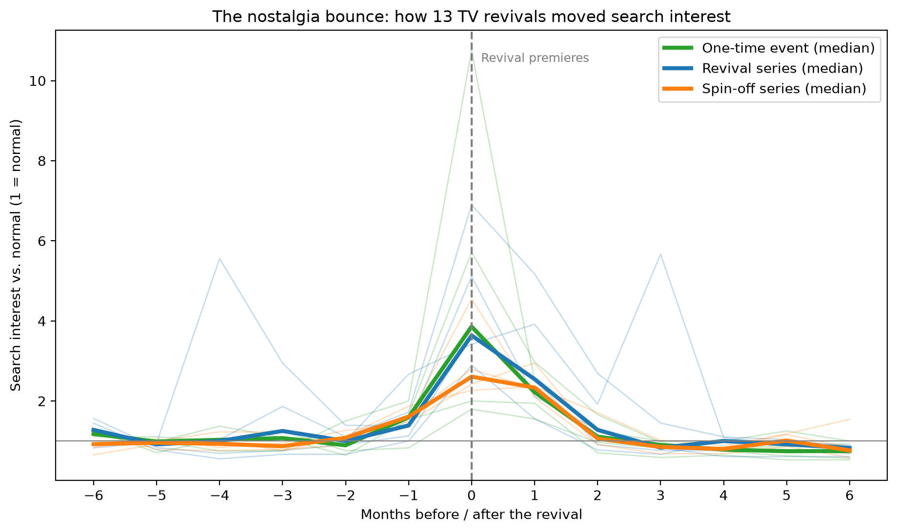
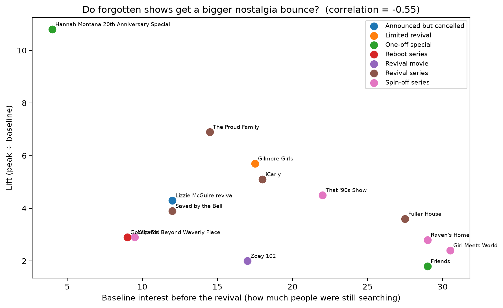
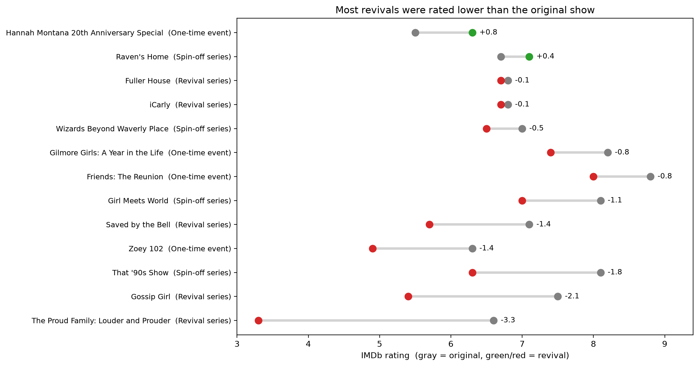

# Does Nostalgia Pay? What 14 TV Revivals Reveal About Bringing Shows Back

**Question:** When a studio brings back a 2000s-era show, what predicts a big audience reaction: the format, or how much the show had faded?

It started with Hannah Montana. Disney's 20th anniversary special (March 2026) drove a **10.8x spike** in search interest, the biggest of any revival I found. So I looked at 14 revival moments across Disney, Nickelodeon, Netflix, HBO Max, and Peacock to see what was behind it.

## Key Findings

**1. Revivals create a short burst, not a lasting comeback.**
Every format followed the same shape: a small rise the month before (trailers and announcements), a spike at premiere, and a return to normal interest within 2–3 months.

**2. Format matters: revival series were the most reliable, spin-offs the weakest.**

| Format | Revivals | Median lift | Range |
|---|---|---|---|
| Revival series (original show returns) | 5 | 3.9x | 2.9x – 6.9x |
| One-time event (special, movie, limited) | 4 | 3.9x | 1.8x – 10.8x |
| Spin-off series (new lead characters) | 4 | 2.9x | 2.4x – 4.5x |

One-time events were high-risk, high-reward: they produced both the biggest spike (Hannah Montana) and the smallest (Friends: The Reunion). Spin-offs never passed 4.5x, possibly because nostalgia is tied to specific characters, and spin-offs center on new ones.

**3. Shows that had faded more tended to bounce higher.**

Shows with lower search interest before their revival tended to get bigger spikes (correlation −0.55). Without Hannah Montana, the pattern weakens (−0.33) but holds, so it's a moderate tendency rather than a rule.

**4. Buzz isn't the same as approval: most revivals were rated lower than the original.**

Only 2 of 13 aired revivals were rated higher than the original on IMDb, and the typical revival dropped 0.8 points. The Proud Family's revival had the second-biggest spike (6.9x) but the biggest rating drop (−3.3).

## Case Study: Hannah Montana

The Hannah Montana special was the biggest outlier on both measures: the largest spike (10.8x) and the only revival rated meaningfully higher than its original (+0.8). It had also faded the most before returning, but its spike was far beyond what that alone would predict.

## Takeaway for Studios

- Expect a **short-lived spike**, and plan marketing and merchandise around the premiere window.
- **Full revivals are the safer bet**; one-time events can be huge but are unpredictable.
- **Spin-offs** consistently generate less excitement than bringing back the original characters.
- **Watch reception, not just reach:** a big launch spike doesn't mean audiences are satisfied.

## Data & Methods

- **Google Trends:** monthly US search interest, 2004–present, using each show's TV series topic, downloaded one show at a time (pulled Oct 29, 2026)
- **IMDb non-commercial datasets:** ratings and vote counts, queried with SQL (DuckDB)
- **Lift:** peak interest within 2 months of the revival ÷ median interest in the 12 months before
- **Event study:** each revival aligned at its premiere month, with interest shown relative to its own baseline
- **Tools:** Python (pandas, matplotlib), SQL (DuckDB)

## Limitations

- Google Trends measures relative search interest, not actual viewership.
- 14 revivals is a small sample, so patterns are suggestive, not proven.
- The Lizzie McGuire revival never aired and had only 63 IMDb votes, so it was excluded from ratings comparisons (minimum: 500 votes) and from the format comparison.
- People who rate a revival are often dedicated fans, and sharp rating drops can also reflect online controversy (selection bias).
- Unrelated news can cause spikes (for example, Friends in October 2023).
- Google Trends includes occasional data-collection changes that can cause small shifts.